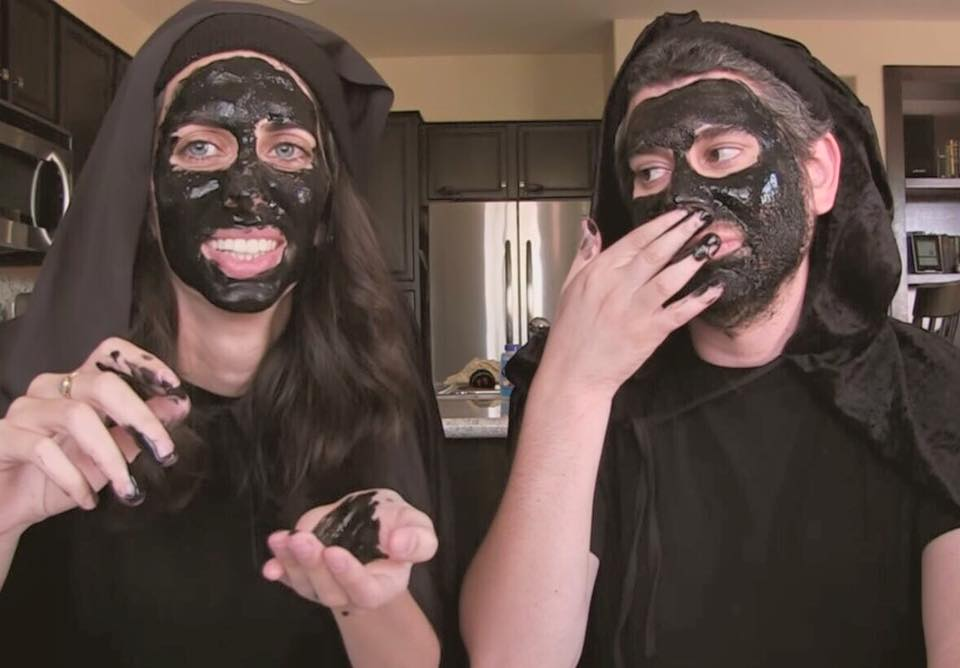
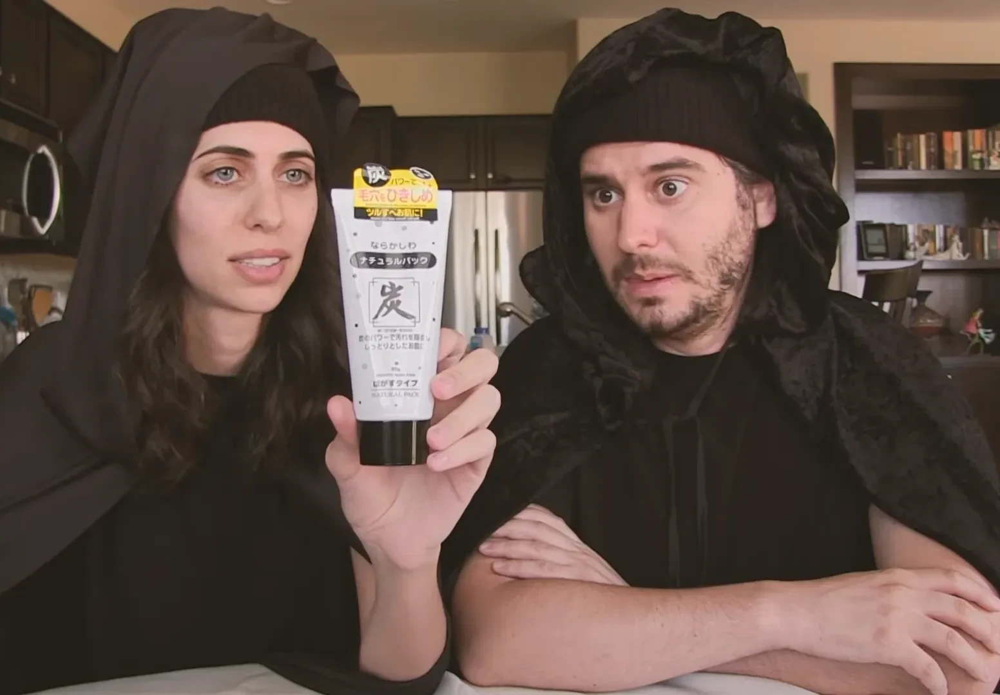
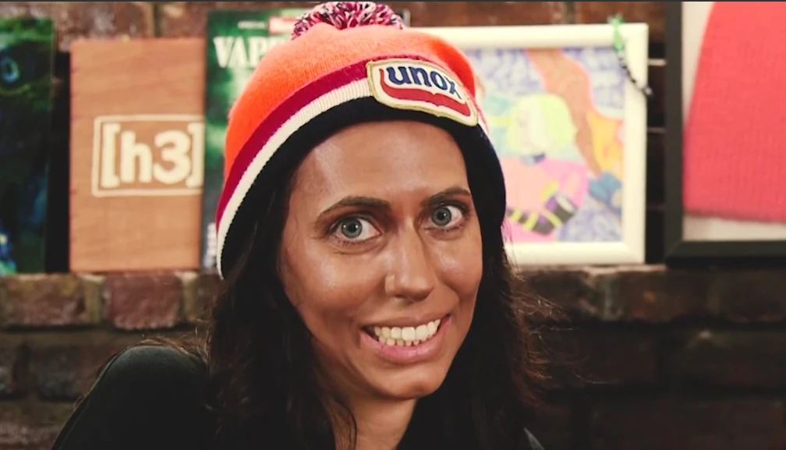
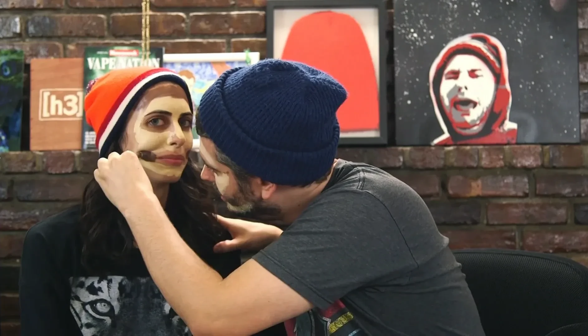
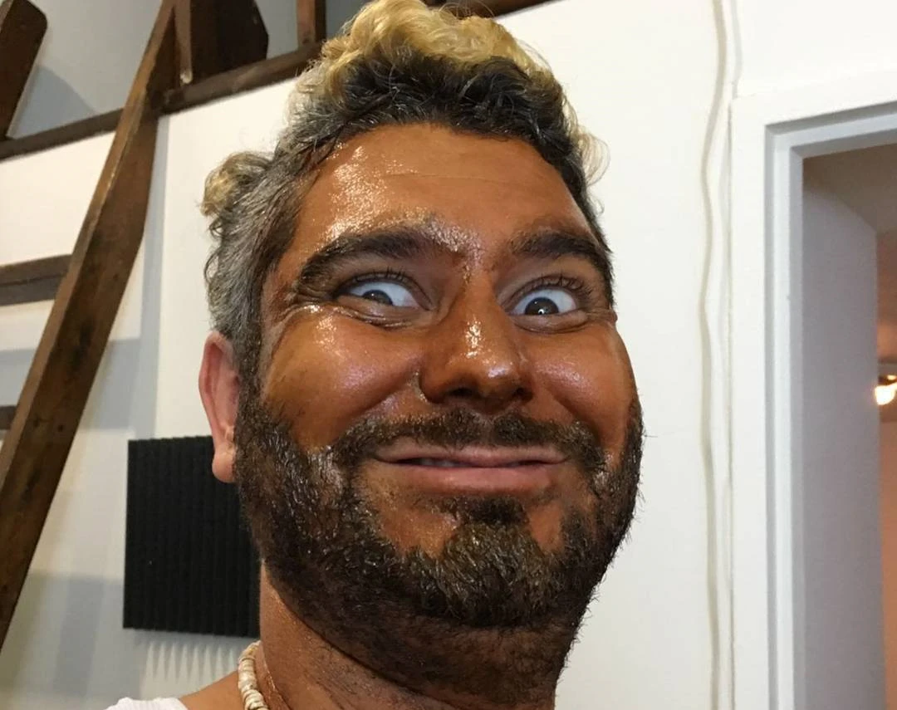
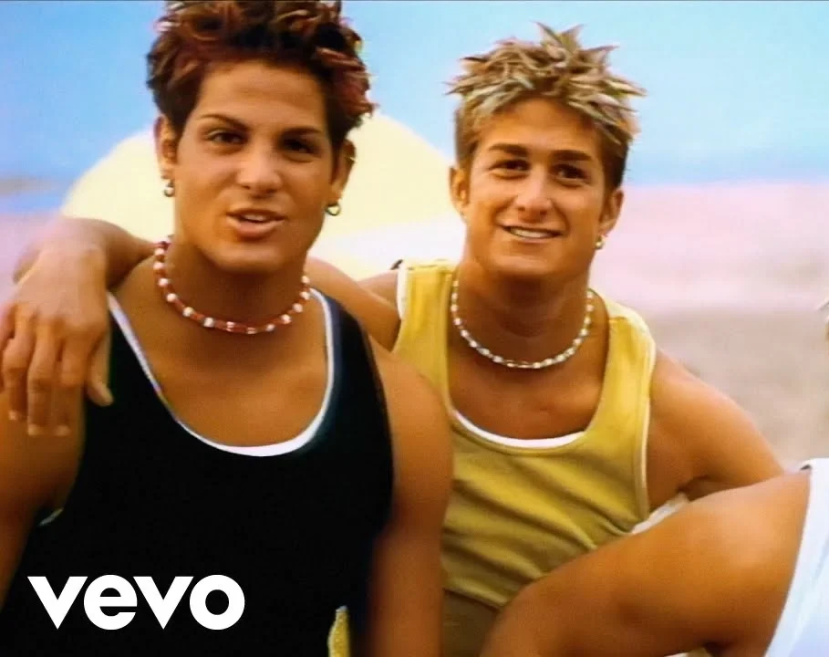
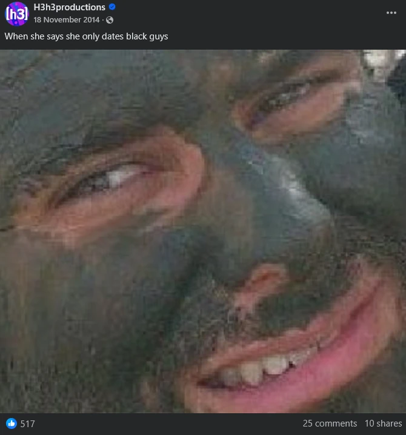
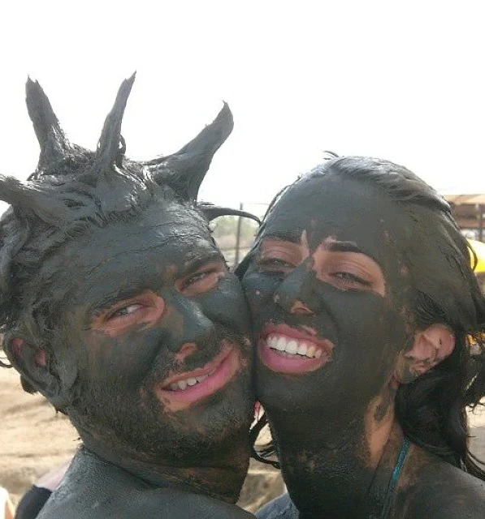

## Background

* The commonly agreed definition of the term "blackface" is "Dark makeup worn to mimic the appearance of a Black person and especially to mock or ridicule Black people".[[1]](#ref1)
* Ethan and Hila have made several "weird product-review" style videos across their old channels. Examples include: "The Dumbest Products Ever Made"[[2]](#ref2), "Gross Soda Challenge"[[3]](#ref3) and "The Black Challenge"[[4]](#ref4).
* In May 2016, Ethan and Hila uploaded "Kim Kardashian's Makeup secret!" on their second channel where they follow a makeup tutorial and apply makeup to each other.[[5]](#ref5)
* In April 2016, Ethan and Hila uploaded "Ethan Joins a 90s Boy Band" on the h3h3Productions channel where they satirized the "B4-4" boy band.[[6]](#ref6)

## Claims

1. Ethan and Hila deliberately wore blackface by wearing charcoal face masks.
2. Ethan deliberately applied makeup on Hila in order to make it seem as if she is wearing blackface.
3. Ethan deliberately wore blackface by getting spray-tanned.
4. Ethan deliberately wore blackface when he posted a photo with mud rubbed on his face captioned "When she says she only dates black guys".

## Truth

### 1. Charcoal Mask

* This screenshot is from the video "The Black Challenge" where Ethan and Hila tried several black-colored beauty products. The products consisted of black hair dye, charcoal toothpaste powder and, more notably, charcoal face masks. They also drank black-colored water.
* The video likely came to be after they accumulated various black-colored products from previous videos.
* As soon as they apply the charcoal mask, Ethan jokingly acknowledges the unfortunate resemblance to "1950s Looney Tunes" caricatures of Black people[[7]](#ref7) but explicitly denies the notion that they are doing blackface.[[8]](#ref8)

### 2. Makeup

* This screenshot is from the aforementioned video where Ethan and Hila follow a tutorial and apply makeup on each other in the popular style of "couples makeup" videos. The comedic twist is that the tutorial promises Kim Kardashian's look.
* Contrary to claims from snarkers, Ethan didn't just straight up paint Hila's face brown. Instead, they applied foundation on their face and contour lines on their cheeks before blending.[[9]](#ref9)
* Ethan, being completely inexperienced with doing makeup, applied the contour lines too thick.[[10]](#ref10) As a result, Hila's makeup ended up being way darker than Ethan's when they blended it with the foundation.
* Ethan acknowledged the resulting look and explicitly denied the notion that it's blackface.[[11]](#ref11)

### 3. Spray Tan

* This screenshot is from the aforementioned video where Ethan and Hila satirize the "B4-4" boy band and their song "Get Down" for its lyrics and music video where the boy band members appear overly spray-tanned.
* Ethan decides to replicate their look by getting frosted tips, wearing earrings, wearing a tank top and, of course, getting overly spray-tanned himself.[[12]](#ref12)
* Ethan has on numerous occasions stated that this was one of the most humiliating videos they made. In his Hot Ones interview, he explained that he always hated the videos where he acted in public, calling it "soul crushing".[[13]](#ref13)
* This directly contradicts the claim that Ethan deliberately put himself in that situation in order to do blackface. The notion that doing blackface was so important to him that he would purposely humiliate himself in public is simply absurd.
* In the same interview, Ethan acknowledged that the spray tan looked questionable and that it could be interpreted as racist but denied it being blackface.[[14]](#ref14)

### 4. Dead Sea Mud

* This screenshot was taken from the h3h3Productions Facebook page, and it's a cropped close-up of a photo Ethan and Hila took during their visit to the Dead Sea where they are covered with mud.[[15]](#ref15)
* Rubbing Dead Sea mud all over your body is a long-standing tradition, believed to be good for the skin and to have health benefits.[[16]](#ref16)
* After Keemstar unearthed the post in 2020, Ethan explained why he rubbed the mud on himself while also acknowledging that the caption was in poor taste.[[17]](#ref17)
* While the caption was in poor taste, it was made after the fact. This, alongside the mud-rubbing tradition, disproves the claim that Ethan deliberately wore blackface when he rubbed the mud on his face.

## Conclusion

* Out-of-context screenshots and clips have circulated appearing to show Ethan and Hila in blackface.
* In reality, while Ethan and Hila have applied dark-colored products on their faces for their videos, the provided context from each incident shows it was not done deliberately in order to mimic the appearance of a Black person.

## References

1. [Merriam-Webster - Blackface Definition](https://www.merriam-webster.com/dictionary/blackface)
2. [YouTube - The Dumbest Products Ever Made](https://www.youtube.com/watch?v=4NqKqDi0yzk)
3. [YouTube - Gross Soda Challenge](https://www.youtube.com/watch?v=lNBO0a5Y1Bw)
4. [YouTube - The Black Challenge (Full Video)](https://www.youtube.com/watch?v=Ml07tIly-uo)
5. [YouTube - Kim Kardashian's Makeup Secret (Full Video)](https://www.youtube.com/watch?v=iqcFFYUmM9E)
6. [YouTube - Ethan Joins a 90s Boy Band (Full Video)](https://www.youtube.com/watch?v=MqgtVpD328o)
7. [The National News - The Censored Eleven](https://www.thenationalnews.com/arts-culture/film-tv/2021/04/10/what-is-the-censored-eleven-the-racist-looney-tunes-and-merrie-melodies-cartoons-banned-since-1968/)
8. [YouTube - The Black Challenge Video](https://www.youtube.com/watch?v=Ml07tIly-uo&t=66)
9. [YouTube - Kim Kardashian's Makeup Secret (Foundation Application)](https://www.youtube.com/watch?v=iqcFFYUmM9E&t=197)
10. [YouTube - Kim Kardashian's Makeup Secret (Contour Lines)](https://www.youtube.com/watch?v=iqcFFYUmM9E&t=230)
11. [YouTube - Kim Kardashian's Makeup Secret (Ethan's Denial)](https://www.youtube.com/watch?v=iqcFFYUmM9E&t=397)
12. [YouTube - Ethan Joins a 90s Boy Band (Spray Tan)](https://www.youtube.com/watch?v=MqgtVpD328o&t=540)
13. [YouTube - Hot Ones Interview (Soul Crushing)](https://www.youtube.com/watch?v=Tgw2Kkmupg8&t=357s)
14. [YouTube - Hot Ones Interview (Spray Tan Acknowledgment)](https://www.youtube.com/watch?v=Tgw2Kkmupg8&t=377)
15. [Instagram - Dead Sea Mud Photo](https://www.instagram.com/h3h3productions/p/vi0uBPjM5K)
16. [Healthline - Dead Sea Mud Benefits](https://www.healthline.com/health/dead-sea-mud)
17. [Archive.is - Ethan's Explanation](https://archive.is/rlbhS)
